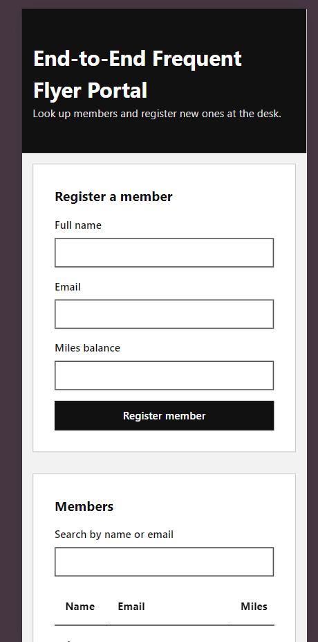

# ✈️ End-to-End Frequent Flyer Portal

End-to-End Frequent Flyer Portal is a responsive web application that replaces the paper and Excel sheets used by airline floor staff. Staff can look up frequent flyer members, register new ones, and remove existing ones from a single screen. It stays usable on slow or spotty connections.


---

## 🚀 Live Demo
👉 End-to-End Frequent Flyer Portal live website: (https://frequent-flyer-portal-lovat.vercel.app/)

---

## 📸 Project Screenshots

### Desktop Preview


### Mobile Preview



---

## ✨ Features

- View all frequent flyer members in an accessible table
- Search members by name or email
- Register a new member (name, email, miles balance)
- Automatic tier: Blue, Silver, Gold or Platinum based on miles
- Remove a member with one click
- Data saved in localStorage, so it survives a page reload and works offline
- Simulated async API with visible loading states
- Friendly "No data found" message instead of a blank screen
- Form validation with red field highlighting and clear error messages
- Error banner with a Retry button when loading or saving fails
- Simulated analytics ping logged to the console on every completed action
- XSS sanitization of all text inputs before they enter state
- Fully keyboard navigable with visible focus rings
- Responsive layout for desktop, tablet, and mobile

---

## 🧰 Tech Stack

- React 18
- Vite
- JavaScript
- CSS (custom properties, monochrome design system)
- Vitest
- React Testing Library
- ESLint (with `jsx-a11y` and `react-hooks` plugins)
- Local Storage
- Vercel / Netlify (deployment)

---

## ✅ Requirements Coverage

### Happy Path

| User story | How it is met |
| --- | --- |
| Access the portal interface clearly | Single-page layout with a header, a register form and a members table |
| Respond immediately without long loading screens | Local simulated API (700 ms) and instant client-side search |
| Structured, consistent data | Every member has `id`, `name`, `email`, `miles`, with a derived tier |

### Unhappy Path

| Failure state | Behaviour |
| --- | --- |
| Empty state | Shows "No data found" with a hint, never a blank screen |
| Bad connectivity | `role="status"` loading indicator on load and on save; error banner with Retry |
| Invalid inputs | Submit is blocked, fields turn red with `aria-invalid`, error text is linked via `aria-describedby`, and focus moves to the first bad field |

### Non-Functional Requirements

| NFR | Implementation |
| --- | --- |
| Accessibility | Labelled inputs, semantic landmarks, table with `caption` and `scope`, 44px touch targets, AA contrast, `aria-label` on Remove buttons |
| Telemetry | `[Analytics] User interacted with End-to-End Frequent Flyer Portal` logged after a completed register or remove (`src/lib/analytics.js`) |
| Security | `sanitize()` strips HTML tags and control characters before storing values (`src/lib/input.js`) |
| Design handoff | Greys only (plus one error red), spacing in 16px and 32px steps, all colours as CSS variables |

---

## 🗂️ Folder Layout

```
├── PROMPTS.md            Prompt traceability log
├── README.md
├── index.html
├── package.json
├── vite.config.js        Vite + Vitest config
├── eslint.config.js
└── src/
    ├── main.jsx
    ├── App.jsx           UI and state
    ├── App.css           Monochrome design system
    ├── App.test.jsx      Happy path, unhappy path and NFR tests
    ├── lib/
    │   ├── api.js        Simulated async backend (localStorage)
    │   ├── input.js      sanitize, validate, tierFor
    │   ├── input.test.js
    │   └── analytics.js  Telemetry ping
    └── test/setup.js
```

---

## ⚙️ Getting Started

```bash
npm install
npm run dev
```

| Command | Purpose |
| --- | --- |
| `npm run dev` | Start the development server |
| `npm test` | Run the full test suite once |
| `npm run test:watch` | Run tests in watch mode |
| `npm run lint` | ESLint with zero warnings allowed |
| `npm run build` | Create the production build in `dist/` |
| `npm run preview` | Preview the production build |

---

## 🧪 Testing

The project follows Test-Driven Development. Tests were written before the implementation.

- 16 tests across 2 files, all passing
- Happy path: list rendering, registering a member, removing a member
- Unhappy path: loading indicator, empty search state, blocked invalid submission, failed load with Retry
- NFRs: XSS sanitization, accessible names on all controls, keyboard tab order, analytics logging
- Unit tests for `sanitize`, `validate` and `tierFor`

---

## 🤖 Vibe Coding Workflow

1. **TDD via AI:** acceptance criteria and NFRs were fed to the AI, the test suite was written first, and the implementation followed.
2. **Iterative loop:** errors were pasted back into the chat with "That approach caused an error. Let's revert and try a different method." Code was not rewritten by hand.
3. **Prompt traceability:** the exact prompt sequence is documented in [`PROMPTS.md`](./PROMPTS.md).

---

